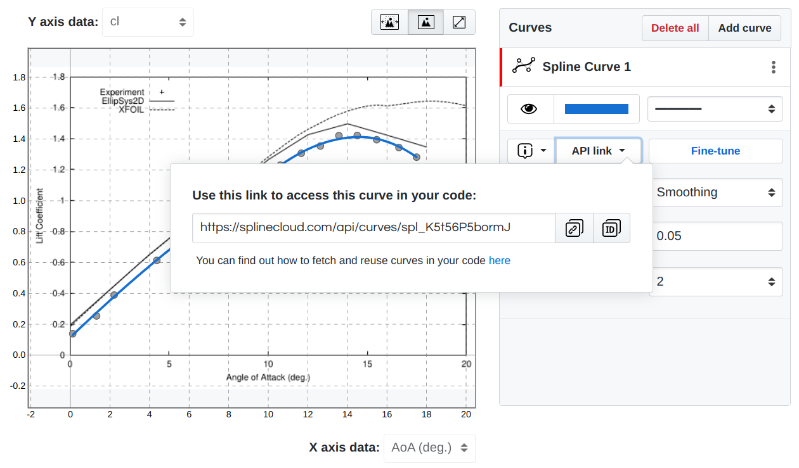
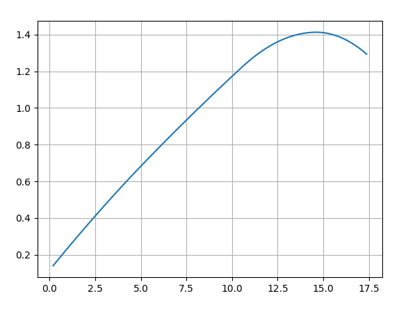
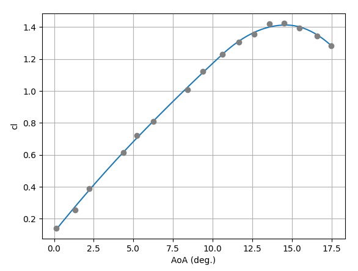

# splinecloud-scipy

A Python client for [SplineCloud API](https://splinecloud.com/api/docs/)

The client library is based on [SciPy](https://scipy.org/) and allows to load data and curves from [SplineCloud](https://splinecloud.com/) into your code. Once loaded spline curves can be easily evaluated.

## Installation

```
pip install splinecloud-scipy
```

## Example of loading spline curve



```python
from splinecloud_scipy import load_spline

curve_id = 'spl_K5t56P5bormJ' # take curve ID from the 'API link' dropdown at SplineCloud
spline = load_spline(curve_id)
```

## Evaluating spline curve for a range of x values

```python
import numpy as np
import matplotlib.pyplot as plt

X = np.linspace(0, 20, 100)
Y = [spline.eval(x) for x in X]

plt.plot(X,Y)
plt.grid()
plt.show()
```



## Load data fitted by spline and evaluate fit accuracy

```python
columns, table = spline.load_data()
x_data, y_data = table.T

plt.plot(X,Y)
plt.plot(x_data, y_data, 'o', color="grey")
plt.grid()
plt.xlabel(columns[0])
plt.ylabel(columns[1])
plt.show()
```



```python
RMSE = spline.fit_accuracy(table, method="RMSE")
print(RMSE)

0.011307453345329156
```


## Explicit and parametric curves

Each curve has a `form`. Curves that are functions of x - most smoothing, least-squares and
interpolating fits - are `"explicit"`, and `load_spline` returns an `ExplicitUnivariateSpline`
that evaluates y(x) directly. Curves that aren't (data that isn't ordered in x, parametric
fits, control points edited sideways, NURBS) are `"parametric"` and load as
`ParametricUnivariateSpline`. Both have the same `eval(x, extrapolate=False)` and
`fit_accuracy` API, so code using them doesn't change.

```python
spline = load_spline('spl_K5t56P5bormJ')
spline.form          # 'explicit' or 'parametric'
spline.eval(X)       # NaN outside the curve's x range unless extrapolate=True
```

Explicit curves evaluate much faster (about 400x for 10,000 points), and also accept an
extrapolation policy: `spline.eval(X, extrapolate="linear")` (or `"clamp"`, `"polynomial"`,
`"none"`). `spline.to_parametric()` returns the equivalent `ParametricUnivariateSpline`.

Requires SciPy >= 1.12.

## Spline surfaces: lofted and fitted

`load_spline_surface` (or `load_model`) returns the class that matches the surface's `form`:

- **Lofted surfaces** (`form == "parametric"`, built from curves) load as `SplineSurface`, as
  before. Their control points now come in the order `[x1, x2, y]` (inputs, then the
  response), as for every other model; splinecloud-scipy 1.5 is needed to read them.
- **Fitted surfaces** (`form == "explicit"`, a smooth surface y = f(x1, x2) fitted to a table
  of points) load as `ExplicitSplineSurface`. They need splinecloud-scipy >= 1.5; older
  versions can only read lofted surfaces.

`ExplicitSplineSurface.eval(x1, x2)` works like `SplineSurface.eval`, so existing code keeps
working: scalars give a float, arrays give the outer-product grid `X1, X2, Y`, and
`compute_gradients=True` adds dy/dx1 and dy/dx2. Points outside the fitted domain give NaN
unless `extrapolate=True` (linear extrapolation from the nearest domain point) or a policy
name (`"linear"`, `"clamp"`, `"polynomial"`, `"none"`).

```python
from splinecloud_scipy import load_model

surface = load_model('srf_xxxxxxxxxxxx')  # a surface uid (load_model also takes spl_, hsf_, drn_)
surface.form                            # 'explicit' for fitted surfaces
surface.eval(4.0, 0.3)                  # y at x1 = 4.0, x2 = 0.3
X1, X2, Y = surface.eval(x1_values, x2_values)
```

Fitted surfaces also have a direct, pointwise API and their fit report:

```python
surface(x1_array, x2_array)             # pointwise, with NumPy broadcasting
surface.eval_grid(x1_values, x2_values) # Y only, shape (len(x1_values), len(x2_values))
surface.grad(points)                    # (n, 2) gradients at (n, 2) points
surface.slice({1: 0.3})                 # the curve y(x1) at x2 = 0.3 (exact)
surface.domain                          # [[x1_min, x1_max], [x2_min, x2_max]]
surface.accuracy                        # {'r2': ..., 'rmse': ..., 'n': ...}
surface.fit_status                      # 'ok', 'not_converged' or 'pending'

labels, data = surface.load_data()      # the (N, 3) [x1, x2, y] points it was fitted to
surface.excluded_points                 # points excluded from the fit (None if none)
```

A surface can be fitted to a long table (one row per point, x1 / x2 / y columns) or to a
grid table, such as a handbook lookup table: x1 down the first column, x2 in the column
headers (or in the first row), y in the cells. `load_data()` returns the same `[x1, x2, y]`
points either way. For a grid, that is one point per filled cell, row by row, and
`surface.data_format` is `"matrix"` (`"vector"` for long tables). `melt_grid(columns, table,
mapping)` does the same for a table from `load_subset`. Grid headers and x1 cells may be
labelled, as `Re=1e5` or `Mach: 0.8`, when every value of the axis carries the same label.

A surface can also be fitted to several subsets at once, such as the contour lines of a chart
digitised as one subset per line: each subset holds (x, y) points at a constant z, its z
value, and the surface is z = f(x, y). `load_data()` then loads every subset and returns
their points one after another, z filled in from each subset's value, and
`surface.data_format` is `"stacked"`. `surface.sources` lists the subsets in that order
(`subset_uid`, `z`, `n_points`); a subset without a z value is left out.
`stack_subsets(sources, tables, mapping)` does the same for tables from `load_subset`.

### Which variable a surface models

Lofted and stacked relations are built from curves (or subsets) at constant levels: each
curve gives y over x at its level z. The relation's author chooses which of the three the
surface models - by default y = f(x, z) for lofted relations (a curve family) and
z = f(x, y) for stacked ones (contour lines) - and the inputs are the other two, in
(x, y, z) order. `surface.response_axis` is that variable (`"x"`, `"y"` or `"z"`),
`surface.variables` their names, and `surface.labels` the roles `[x1, x2, y]`.

```python
surface = load_model('srf_xxxxxxxxxxxx')   # a terrain lofted through its contour lines
surface.response_axis                      # 'z'
surface.variables                          # {'x': 'Easting', 'y': 'Northing', 'z': 'Altitude'}
surface.labels                             # ['Easting', 'Northing', 'Altitude']
surface.eval(easting, northing)            # the altitude there
labels, data = surface.load_data()         # [x1, x2, y] rows: easting, northing, altitude
```

Evaluation always takes the two inputs and returns the response. Where the surface folds
over its inputs' plane (some inputs have two responses), it returns one of them; the
platform warns about such surfaces. `role_variables(response_axis)` gives the role ->
variable map.

`surface.to_parametric()` returns the same surface as a `ParametricBivariateSpline`.

## Hypersurfaces: models with 3 or 4 inputs

A hypersurface is a smooth function y = f(x1, ..., xn) with n = 3 or 4 inputs, fitted to a
table on SplineCloud (a multivariate relation). `load_spline_hypersurface` (or `load_model`
with an `hsf_` uid) returns a `SplineHyperSurface`. It needs splinecloud-scipy >= 1.5.

```python
from splinecloud_scipy import load_model

hs = load_model('hsf_xxxxxxxxxxxx')     # a hypersurface uid
hs.labels                               # ['Re', 'Pr', 'L/D', 'Tw/Tb', 'Nu']: inputs, then y
hs(1e5, 7.0, 30.0, 1.2)                 # y at one point (inputs in the order of hs.labels)
hs(re_array, pr_array, ld_array, tw_array)   # pointwise, with NumPy broadcasting
hs.eval(points)                         # (m, n) points -> (m,) values
hs.eval_grid(re_values, pr_values, ld_values, tw_values)   # the outer-product grid
hs.grad(points)                         # (m, n) gradients
hs.domain                               # [[min, max], ...] per input
```

Points outside the fitted domain give NaN. Pass a policy to extrapolate, per call
(`hs.eval(points, extrapolate="linear")`) or when loading
(`load_spline_hypersurface(uid, extrapolation="clamp")`): `"none"`, `"linear"`, `"clamp"` or
`"polynomial"`. Logarithmic axes are handled: pass and get physical values.

Fix some inputs to get a lower-dimensional model, by input label or index:

```python
surface = hs.slice({"L/D": 30.0, "Tw/Tb": 1.2})   # y(Re, Pr): an NdBsplExplicit
curve = hs.slice({1: 7.0, 2: 30.0, 3: 1.2})       # y(Re): an ExplicitUnivariateSpline
```

The fit report and the data are there too: `hs.accuracy`, `hs.fit_status` (`'ok'`,
`'not_converged'` or `'pending'`), `hs.fit_params`, and `labels, data = hs.load_data()` for
the (N, n + 1) `[x1, ..., xn, y]` points it was fitted to (`hs.excluded_points` marks the ones
left out of the fit).

`load_multivariate_relation('drn_xxxxxxxxxxxx')` (or `load_model` with a `drn_` uid) returns
the relation with all its hypersurfaces: `relation.hypersurfaces`,
`relation.hypersurface("Spline Hypersurface 1")`, `relation.data_mapping` (the input and
output columns) and `relation.load_data()`.

## Lofted volumes: 2-D models stacked along a third input

A lofted volume is y = f(x1, x2, x3) built on SplineCloud by stacking 2-D models (lofted or
fitted surfaces, the *stations*) at values of a third input x3 (a lofted 3D relation). The
volume passes through every station exactly and is smooth between them. Lofted volumes are
hypersurfaces too: `load_spline_hypersurface` (or `load_model`) with their `hsf_` uid returns a
`SplineVolume`. It needs splinecloud-scipy >= 1.5.

```python
from splinecloud_scipy import load_model

vol = load_model('hsf_xxxxxxxxxxxx')    # a lofted volume's uid
vol.labels                              # ['eta', 'TR', 'AR', 'cla*']: x1, x2, x3, then y
vol.x3_stations                         # [6.0, 8.0, 10.0, 12.0]
vol.eval(0.5, 0.6, 9.0)                 # y at one point
vol.eval(x1_values, x2_values, x3_values)   # the outer-product grid (NaN where undefined)
surface = vol.slice_at(9.0)             # the exact surface at x3 = 9: y(x1, x2)
surface.eval(0.5, 0.6)
```

x3 outside the stations' range is clamped to it; `vol.eval(..., extrapolate=True)` extends the
volume a little beyond (up to half the range, `w_distance_threshold`) and lets the slice
extrapolate in x1 and x2. Logarithmic axes are handled: pass and get physical values.

`vol.load_station_surfaces()` loads the stations (each with `load_data()` for its data
points). `load_model('lr3_xxxxxxxxxxxx')` (or `load_lofted_relation_3d`) returns the lofted 3D
relation: `relation.stations` (x3 values and surfaces), `relation.volume`.

## Example of loading data in your code

```python
from splinecloud_scipy import load_subset
subset_id = 'sbt_nDO4XmmYqeGI' # subset id can be taken from the SplineCloud
columns, table = load_subset(subset_id)
```

```
>>> columns

['Throttle (%)',
 'Load Currency (A)',
 'Pull (g)',
 'Power (W)',
 'Efficiency (g/W)']
```

```
>>> table

array([[5.0000e-01, 6.7600e+00, 3.8500e+02, 1.0871e+02, 3.5420e+00],
       [6.0000e-01, 1.0200e+01, 4.9500e+02, 1.6249e+02, 3.0460e+00],
       [7.0000e-01, 1.3580e+01, 6.0600e+02, 2.1768e+02, 2.7840e+00],
       [8.0000e-01, 1.7390e+01, 6.8700e+02, 2.7140e+02, 2.5510e+00],
       [9.0000e-01, 2.1030e+01, 7.4700e+02, 3.2813e+02, 2.2770e+00],
       [1.0000e+00, 2.5060e+01, 8.0700e+02, 3.8555e+02, 2.0930e+00]])
```

These examples are available as notebooks in the project's 'examples' folder.

## Important

This library supports BSpline geometry but does not support weighted BSplines (NURBS). If you adjust the weights of the curve control points use another client, that supports NURBS (a link will be provided here soon).