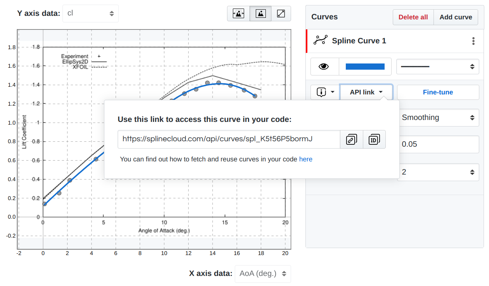
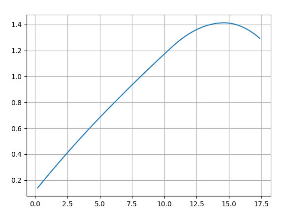
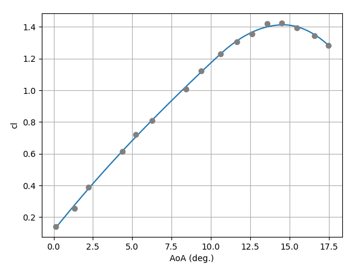

# splinecloud-scipy

A Python client for [SplineCloud API](https://splinecloud.com/api/docs/)

The client library is based on [SciPy](https://scipy.org/) and allows to load data and curves from [SplineCloud](https://splinecloud.com/) into your code. Once loaded spline curves can be easily evaluated.

## Installation

```
pip install splinecloud-scipy
```

## Example of loading spline curve



```python
from splinecloud_scipy import load_spline

curve_id = 'spl_K5t56P5bormJ' # take curve ID from the 'API link' dropdown at SplineCloud
spline = load_spline(curve_id)
```

## Evaluating spline curve for a range of x values

```python
import numpy as np
import matplotlib.pyplot as plt

X = np.linspace(0, 20, 100)
Y = [spline.eval(x) for x in X]

plt.plot(X,Y)
plt.grid()
plt.show()
```



## Load data fitted by spline and evaluate fit accuracy

```python
columns, table = spline.load_data()
x_data, y_data = table.T

plt.plot(X,Y)
plt.plot(x_data, y_data, 'o', color="grey")
plt.grid()
plt.xlabel(columns[0])
plt.ylabel(columns[1])
plt.show()
```



```python
RMSE = spline.fit_accuracy(table, method="RMSE")
print(RMSE)

0.011307453345329156
```


## Explicit and parametric curves

Each curve has a `form`. Curves that are functions of x - most smoothing, least-squares and
interpolating fits - are `"explicit"`, and `load_spline` returns an `ExplicitUnivariateSpline`
that evaluates y(x) directly. Curves that aren't (data that isn't ordered in x, parametric
fits, control points edited sideways, NURBS) are `"parametric"` and load as
`ParametricUnivariateSpline`. Both have the same `eval(x, extrapolate=False)` and
`fit_accuracy` API, so code using them doesn't change.

```python
spline = load_spline('spl_K5t56P5bormJ')
spline.form          # 'explicit' or 'parametric'
spline.eval(X)       # NaN outside the curve's x range unless extrapolate=True
```

Explicit curves evaluate much faster (about 400x for 10,000 points), and also accept an
extrapolation policy: `spline.eval(X, extrapolate="linear")` (or `"clamp"`, `"polynomial"`,
`"none"`). `spline.to_parametric()` returns the equivalent `ParametricUnivariateSpline`.

Requires SciPy >= 1.12.

## Spline surfaces: lofted and fitted

`load_spline_surface` (or `load_model`) returns the class that matches the surface's `form`:

- **Lofted surfaces** (`form == "parametric"`, built from curves) load as `SplineSurface`, as
  before.
- **Fitted surfaces** (`form == "explicit"`, a smooth surface y = f(x1, x2) fitted to a table
  of points) load as `ExplicitSplineSurface`. They need splinecloud-scipy >= 1.5; older
  versions can only read lofted surfaces.

`ExplicitSplineSurface.eval(x1, x2)` works like `SplineSurface.eval`, so existing code keeps
working: scalars give a float, arrays give the outer-product grid `X1, X2, Y`, and
`compute_gradients=True` adds dy/dx1 and dy/dx2. Points outside the fitted domain give NaN
unless `extrapolate=True` (linear extrapolation from the nearest domain point) or a policy
name (`"linear"`, `"clamp"`, `"polynomial"`, `"none"`).

```python
from splinecloud_scipy import load_model

surface = load_model('srf_xxxxxxxxxxxx')  # a surface uid (load_model also takes spl_ uids)
surface.form                            # 'explicit' for fitted surfaces
surface.eval(4.0, 0.3)                  # y at x1 = 4.0, x2 = 0.3
X1, X2, Y = surface.eval(x1_values, x2_values)
```

Fitted surfaces also have a direct, pointwise API and their fit report:

```python
surface(x1_array, x2_array)             # pointwise, with NumPy broadcasting
surface.eval_grid(x1_values, x2_values) # Y only, shape (len(x1_values), len(x2_values))
surface.grad(points)                    # (n, 2) gradients at (n, 2) points
surface.slice({1: 0.3})                 # the curve y(x1) at x2 = 0.3 (exact)
surface.domain                          # [[x1_min, x1_max], [x2_min, x2_max]]
surface.accuracy                        # {'r2': ..., 'rmse': ..., 'n': ...}
surface.fit_status                      # 'ok', 'not_converged' or 'pending'

labels, data = surface.load_data()      # the (N, 3) [x1, x2, y] points it was fitted to
surface.excluded_points                 # points excluded from the fit (None if none)
```

`surface.to_parametric()` returns the same surface as a `ParametricBivariateSpline`.

## Example of loading data in your code

```python
from splinecloud_scipy import load_subset
subset_id = 'sbt_nDO4XmmYqeGI' # subset id can be taken from the SplineCloud
columns, table = load_subset(subset_id)
```

```
>>> columns

['Throttle (%)',
 'Load Currency (A)',
 'Pull (g)',
 'Power (W)',
 'Efficiency (g/W)']
```

```
>>> table

array([[5.0000e-01, 6.7600e+00, 3.8500e+02, 1.0871e+02, 3.5420e+00],
       [6.0000e-01, 1.0200e+01, 4.9500e+02, 1.6249e+02, 3.0460e+00],
       [7.0000e-01, 1.3580e+01, 6.0600e+02, 2.1768e+02, 2.7840e+00],
       [8.0000e-01, 1.7390e+01, 6.8700e+02, 2.7140e+02, 2.5510e+00],
       [9.0000e-01, 2.1030e+01, 7.4700e+02, 3.2813e+02, 2.2770e+00],
       [1.0000e+00, 2.5060e+01, 8.0700e+02, 3.8555e+02, 2.0930e+00]])
```

These examples are available as notebooks in the project's 'examples' folder.

## Important

This library supports BSpline geometry but does not support weighted BSplines (NURBS). If you adjust the weights of the curve control points use another client, that supports NURBS (a link will be provided here soon).